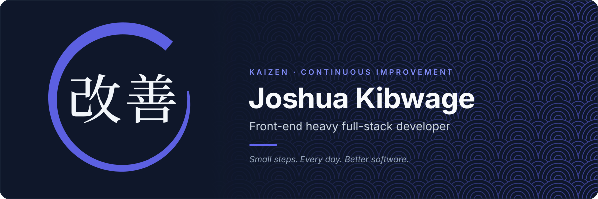

---

## About

I'm a front-end heavy full-stack developer in Nairobi, Kenya, with a graphic design background, so I care as much about how a product feels as how it's built. I've shipped production sites for service businesses across the US, and I'm happy working independently or inside a team. I live by **kaizen**: small, steady improvements every day. Open to **freelance projects** and **remote full-time roles**.

---

## Tech Stack

**Frontend**  

**State and Data Fetching**  

**Backend and Databases**  

**Cloud, DevOps and Tooling**  

**Design and AI Tools**  

**Also:** Vitest · Supertest · Storybook · Auth.js · Cloudinary · SendGrid · SEO · Accessibility (WCAG 2.2 AA) · Performance optimization · Graphic design

---

## Featured Projects

<table>
  <tr>
    <td width="50%" valign="top">
      <h3><a href="https://github.com/Joshuakibwage/booking-platform">Multi-Tenant Booking Platform</a></h3>
      Booking and scheduling platform where multiple businesses run their own branded booking pages. <i>In development.</i>  
      <b>YOUR_STACK · pnpm · Turborepo</b>  
      <a href="https://github.com/Joshuakibwage/booking-platform">Code</a>
    </td>
    <td width="50%" valign="top">
      <h3><a href="https://github.com/Joshuakibwage/ember-and-bean">Ember &amp; Bean</a></h3>
      Full-stack coffee shop app with authentication, admin dashboard CRUD, and Paystack checkout for pickup or delivery.  
      <b>Next.js · TypeScript · MongoDB · Auth.js</b>  
      <a href="https://github.com/Joshuakibwage/ember-and-bean">Code</a>
    </td>
  </tr>
</table>

---

## Currently

- Building a **multi-tenant booking platform** (pnpm + Turborepo monorepo)
- Learning **SQL, MySQL, and PostgreSQL**
- Growing my **Figma and design systems** skills
- Growing my freelance web studio

---

## Work With Me

I help small businesses and startups in **Kenya and the US** with web design and development, SEO, performance optimization, branding, and backend automation (payments, CRM, and webhook integrations).

**[Let's talk →](mailto:joshuakibwage23@gmail.com)**

---

## GitHub Stats

<picture>
  <source media="(prefers-color-scheme: dark)" srcset="https://github-readme-stats.vercel.app/api?username=Joshuakibwage&show_icons=true&hide_border=true&bg_color=00000000&title_color=818CF8&icon_color=818CF8&text_color=C9D1D9&count_private=true" />
  <source media="(prefers-color-scheme: light)" srcset="https://github-readme-stats.vercel.app/api?username=Joshuakibwage&show_icons=true&hide_border=true&bg_color=00000000&title_color=4F46E5&icon_color=4F46E5&text_color=24292F&count_private=true" />
  
</picture>
<picture>
  <source media="(prefers-color-scheme: dark)" srcset="https://github-readme-stats.vercel.app/api/top-langs/?username=Joshuakibwage&layout=compact&hide_border=true&bg_color=00000000&title_color=818CF8&text_color=C9D1D9" />
  <source media="(prefers-color-scheme: light)" srcset="https://github-readme-stats.vercel.app/api/top-langs/?username=Joshuakibwage&layout=compact&hide_border=true&bg_color=00000000&title_color=4F46E5&text_color=24292F" />
  
</picture>

<picture>
  <source media="(prefers-color-scheme: dark)" srcset="https://streak-stats.demolab.com?user=Joshuakibwage&hide_border=true&background=00000000&ring=818CF8&fire=818CF8&currStreakNum=C9D1D9&sideNums=C9D1D9&currStreakLabel=818CF8&sideLabels=8B949E&dates=8B949E" />
  <source media="(prefers-color-scheme: light)" srcset="https://streak-stats.demolab.com?user=Joshuakibwage&hide_border=true&background=00000000&ring=4F46E5&fire=4F46E5&currStreakNum=24292F&sideNums=24292F&currStreakLabel=4F46E5&sideLabels=57606A&dates=57606A" />
  
</picture>

